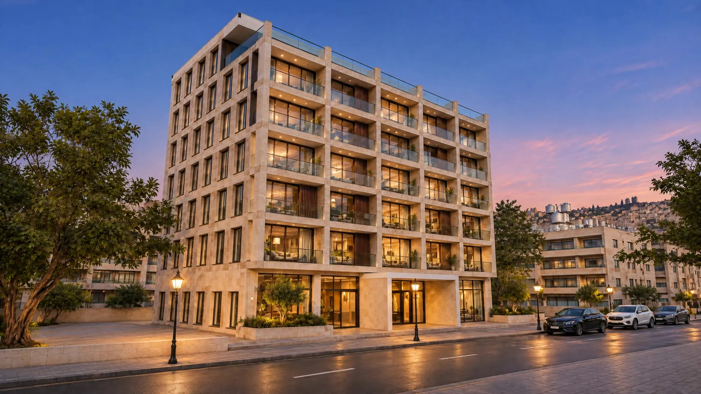

# JEC | AlJallad Contracting — Architectural Experience

**Preview / المعاينة:** https://yallarideapp.github.io/jec-aljallad/



<div dir="rtl">

موقع تجريبي لشركة **الجلاد للمقاولات**: قصة معمارية تتحرك مع التمرير. فيلم بناء من الأرض الفاضية حتى التسليم، ثم تشطيب غرفة واحدة بتسع مراحل، ثم «ما خلف السقف»، ثم قبل وبعد، ثم مشاريع الشركة الحقيقية.

المبنى المعروض **تصوّر معماري** (نموذج ثلاثي الأبعاد في Blender مع Higgsfield AI) وليس مشروعاً منفّذاً، والموقع يذكر ذلك بوضوح. المشاريع الحقيقية مأخوذة من حساب الشركة @jallad.contracting.

</div>

A proof-of-concept website for **JEC | AlJallad Contracting**: a scroll-driven story that follows one building from an empty plot to handover,
then one room through nine finishing stages, what sits above the ceiling, a before/after slider, and the company's real projects.
The building is an **AI architectural visualization** (Blender model + Higgsfield AI), not a completed project; the site says so.

## Run it
```bash
cd Source
npm ci
npm run dev            # same setup as Cloudflare → http://localhost:8787
# or, without npm:  node server.cjs  → http://localhost:8080
```

## What is where
| Path | Contents |
|---|---|
| `Source/` | The site: `index.html` (one file), film clips `v/` `vi/`, phone frames `tiles/`, `media/`, `renders/`, `real/`; Cloudflare setup (`wrangler.jsonc`, `_headers`, `worker/`, `tools/build-dist.mjs`) |
| `Cloudflare-guide.md` | Connecting this repo to Cloudflare (Arabic) |
| `Documents/` | Sources of every fact and image, photoreal stills |
| `Production/` | Blender scripts and the pipeline that turns the AI clips into the site's film |

## Status
Proof of concept for the client's approval. Served with `noindex` until it is approved.
